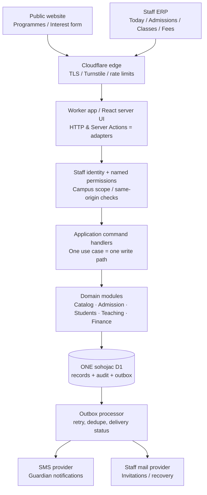

# Sohojac target architecture — enterprise-grade controls, coaching-centre simplicity

**Status:** Proposed Architecture RFC, **not implemented**  
**Reviewed:** 31 October 2026  
**Code baseline:** `master@d53101c7032b60e61428b77ad02ed17709993a89` (read-only source inspection)  
**Companion:** [Operator-first pinpoint audit](./OPERATOR_FIRST_ERP_BLUEPRINT.md)  
**Current phase tracker:** [Development strategy](./DEVELOPMENT_STRATEGY.md)

## 1. Decision in one paragraph

**Redesign the application's boundaries and operator workflow incrementally, but do not rewrite the platform.** Keep the Cloudflare Worker/React/TypeScript stack, the **single `sohojac` D1 database**, staff-only authentication, existing immutable student and staff IDs, audited commands, financial double-entry data and source-parity history. Transform the current collection of database-driven screens into a **task-first modular monolith**: one authoritative command for each business operation, one canonical subject master, one guided programme launch, one admission journey, one financial ledger and shared error/permission/audit primitives. A Fortune 500-grade result is measured by traceability, correctness, accessibility, safe releases and recoverability—not by the number of services, pages, status switches or dashboards.

This RFC proposes actual architecture changes; implementation needs phased, reversible migrations and acceptance evidence. **No live schema, UI, privileges or production data were changed by this document.**

## 2. Non-negotiable constraints

| Decision / invariant | Target behavior |
|---|---|
| One DB | **One Cloudflare D1, named `sohojac`**, shared by dev/main by current owner decision; do not provision a second persistent D1 automatically. Ephemeral local SQLite/D1 tests are permitted and are not another cloud DB. |
| Privacy | Students and guardians never sign in; staff authenticate. Guardian SMS uses verified contact and an approved template. Protect minors' data and minimize field exposure. |
| Product | English-only dark ERP; public site may have Bengali/English content. Default to coaching-center operations, not a generalized K-12 school administration system. |
| Capacity | A batch may hold at most 12 active students; enrollment and transfers enforce the limit atomically. |
| Identity | Preserve original students/staff and `SA-STF-00001` staff number shape. Never mint another canonical student record during returning-student enrollment. |
| Accounting | Financial postings must be money-integer, authorized, idempotent, balanced, attributable and reversible by compensating entries. An invoice does not prove payment. |
| Parity | Existing valuable source behaviors are a contract; UX simplification is allowed when business invariants and history remain. Keep a measurable source parity matrix. |
| Deployment | Feature branch → tested dev → tested master; both Workers share a DB so migrations must be backward-compatible and releases serialized. |

## 3. Architecture diagram



**Not recommended now:** microservices, an event-sourced rewrite, separate databases per function, Kafka, a new large ERP framework, or separate account portals for students/guardians. They add operating burden without solving current correctness defects. Optional Cloudflare R2 for signed documents is **object storage, not a second DB**, and should be introduced only if electronic documents truly need storage. Physical A4 consent remains valid.

### Dependency rule

`app/` routes and `components/` are **interfaces**, never business authorities. They may validate forms and display feedback; they **cannot** implement standalone business writes. `modules/<domain>/application/` orchestrates commands, `modules/<domain>/domain/` contains pure rules, `modules/<domain>/infrastructure/` contains D1 queries. Shared platform code owns auth, authorization, clock, money, idempotency, audit, notifications and errors. Modules may import published interfaces from other domains, not reach into each other's private tables arbitrarily.

Do this **within existing modules**. Do not move the entire repository or introduce a speculative generic repository abstraction; refactor a bounded command only when shipping its tests.

### Proposed code layout (migration target, not current tree)

```text
app/
  (public)/...                 website, programme discovery, interest forms
  dashboard/...                staff routes and task-centric screens
  api/...                      thin, versioned HTTP adapters
modules/
  catalog/                     programme templates, intakes, fee readiness
  curriculum/                  canonical subjects, optional course bundles
  crm/                         enquiries, follow-up, sources
  admissions/                  cases, review, consent, confirmations
  students/                    identity, guardians, enrollments, transfers
  teaching/                    batches, sessions, attendance, assessment
  finance/                     pricing, billing, payments, allocation, journals
  workforce/                   staff identity, assignments, compensation
  communications/              messages/outbox, delivery results
  governance/                  audit events, approvals, retention
platform/
  auth/                        sessions, roles, named permissions, branch scope
  commands/                    idempotency, expectedVersion, result types
  db/                          schema migrations, query adapters, invariants
  money/                       integer paisa, formatting, allocation
  time/                        Asia/Dhaka calendar day, UTC timestamps
  ui/                          form field, error summary, focus, status feedback
scripts/                        repeatable regression / migrations / recovery
migrations/                     immutable historical migrations; forward-only changes
docs/                           strategy, target architecture, operators' UX blueprint, runbook
```

**Avoid layer proliferation:** For a very small feature, one domain command file and one test file are enough. The directory boundaries are a direction, not mandatory boilerplate per CRUD operation.

## 4. Precise domain model

### 4.1 Commercial and academic catalogue

| Canonical concept | Purpose | Data rule |
|---|---|---|
| `Programme` | A reusable product such as SSC A+ Preparation, Annual Readiness or Boys Evening Care | Exists independently of year/campus/class; owns default public description. |
| `Intake` (current programme offering) | A real instance of that programme at a campus for a term/year, with **many eligible classes** and optional stream eligibility | `programme_id`, `campus_id`, `term_id`, stable ID and published state. One multi-class intake can have separate fees/batches where needed. |
| `CurriculumTemplate` | Optional included subjects/topics used in teaching and marketing | A global subject can be used in different class/group contexts via mapping; curriculum is **not required just to publish a public card**. |
| `Batch` | A real seat-limited cohort within an intake | Capacity 1–12 and actual active enrollment count; schedule optional until confirmed. |
| `TeachingSession` | A dated meeting with a teacher, topic/subject, room and attendance | Teacher, room, time conflicts and recorded actuals are separate from tentative preference. |
| `FeePlanVersion` | Approved commercial terms for an intake or class-specific variant | Immutable once published and referenced; any change creates new version and effective interval. |

**Subjects policy: one subject master + contextual relationships, not one subject master row per grade.** Use `subjects(id, code, name_en, name_bn, active)` with stable IDs; `curriculum_templates`, `curriculum_subjects`, `curriculum_applicability` for any genuinely differentiated class/stream. If a programme covers all subjects, a curator uses "Full package" or a default bundle, not 14 checkboxes on Public settings. Keep subject-specific selection only for individual-subject tutoring. Preserve scheduling/result references through an old-to-new ID mapping before retiring `academic_subjects` and `academy_subjects`.

### 4.2 People and admissions

- `Student`: one immutable identity, merge support only through an approved audited action. Never identify a child solely by guardian phone (siblings can share one phone).
- `Guardian` / `StudentGuardianLink`: a person/contact record related to one or more students; relationship is a **link attribute** (mother, father, grandparent, uncle, legal guardian, other), not a duplicate phone record. Existing 27 choices remain configurable; common choices first, rare relationships via search.
- `Prospect`: an optional lead/enquiry, not a prerequisite for direct staff admission.
- `AdmissionCase`: explicit draft → verified → ready for approval → approved → billed → enrolled, with rejected/withdrawn/cancelled outcomes if supported by the source policy. Never jump to billed without consent/verified identity/price.
- `Enrollment`: student × intake × batch × lifecycle. Re-enrolment reuses student identity and snapshots approved fees.
- `ConsentEvidence`: signed paper confirmation date, responsible staff, version and physical file reference; do not fabricate a scan or consent.
- `DiscountApproval` and referral attribution: versioned, permissioned exceptions; scholarship/free-seat offers must have explicit policy, audit trail and budget treatment.

### 4.3 Finance: immutable books beneath simple screens

```text
Published FeePlanVersion
         ↓ snapshot at enrollment
EnrollmentFeeTerms → Invoice + InvoiceLines
                           ↓ actual money received
Payment (one human transaction, unique request key)
                           ↓ allocations
                     Invoice balance
                           ↓
                   Double-entry Journal
         (balanced, posted, immutable; reversal not edit)
```

Retain integer `amount_paisa`, `paid_paisa` and accounting triggers where verified. A fee plan governs **what to charge**, an invoice records **what is owed**, a payment/receipt records **what was actually received**, and a journal records **how books changed**. Cash, bank and mobile financial services have separate clearing/reconciliation. Do not auto-recognize tuition revenue from an invoice if service has not yet been earned; use explicit revenue-recognition rules. Do not silently alter historical tuition when next month's fee changes.

Every operator receipt must display payer/student, amount, method, timestamp, allocated invoice(s), collector, reference and remaining due. Receipt generation must be **idempotent**, not merely guarded against exceeding a balance. Invoice totals are derived with full-population aggregates, not a limited list.

### 4.4 Communications / automation

An **outbox row** is written atomically with the originating command (`message_type`, subject ID, template version, recipient reference, dedupe key, status, attempts, next_attempt_at). A bounded Worker job fetches due rows and sends SMS/staff mail using provider idempotency when available; retries are logged, delivery receipts reconciled and permanent failures surfaced to staff. Keep provider secrets server-side. Do not send messages within a partially committed financial mutation.

For guardians, SMS content must be short, consent/communication preference-aware, and reveal only the minimum needed. Never promise an invoice was paid because an SMS provider accepted a request. No guardian email account or login is required.

## 5. The one-write-path rule: a concrete command contract

A **single use-case handler** is called from the page's Server Action and from any supported API route. No role-only REST shortcut may write the same table independently.

```ts
type CommandContext = {
  actorId: string;              // server-authenticated staff
  campusScope: readonly string[];
  permissions: ReadonlySet<string>;
  requestId: string;            // stable across client retries
  expectedVersion?: number;     // optimistic concurrency, if editing
  nowUtc: string;               // injected clock
  businessDate: string;         // Asia/Dhaka, YYYY-MM-DD
};

type CommandResult<T> =
  | { ok: true; result: T; auditEventId: string; replayed?: boolean }
  | { ok: false; code: "VALIDATION" | "FORBIDDEN" | "CONFLICT" |
      "PRECONDITION" | "RETRY_UNCERTAIN"; message: string; field?: string };
```

### Example: `RecordStudentPayment` transactional contract

1. Authenticate staff, verify email/active membership, require `finance.payments.post` plus campus/account scope; confirm same-origin and request protections.
2. Validate exact non-negative/positive integer-paisa semantics, accepted payment method, invoice/student ownership and outstanding balance; never trust client-computed due.
3. Look up **unique** `(actor_id, command_type, request_id)`; same payload hash returns the **same original receipt**, different payload returns conflict. This check alone is **not enough**: the unique insert belongs in the write transaction.
4. In **one atomic D1 `batch()`**, reserve the request key (or predicate-conditioned row), insert one payment, allocate within available balance, post balanced journal, insert attributable audit event, and optionally outbox event. Guard writes with uniqueness/constraints and conditional predicates. If any required statement fails, roll back the whole batch.
5. On transport timeout/unknown outcome, **query command result** before showing failure or permitting retry. Never create a fresh request ID for a retry of the same intended payment. Cloudflare notes that racing a query against a timeout does not cancel a write that may still commit.
6. Render receipt number, saved state, exact remaining due and an explicit "Print receipt"; printing never posts payment again.

**Non-negotiable tests:** identical POST twice → one receipt/one allocation; concurrent identical requests → same receipt; same key/different payload → conflict; two separate payments cannot over-allocate; unauthorized operator → forbidden; lost network response → replay result; ledger debit = credit; audit and posted journal exist; all failed commands leave no financial partial writes.

This contract generalizes to batch creation, admission finalization, fee publication, enrollment transfers, refunds and staff access grants. Assign exactly one owned command per mutation.

### D1 transaction boundaries

Cloudflare documents `D1Database.batch()` as a transaction that runs sequentially and rolls back the sequence when a statement fails. Use database predicates, unique constraints, foreign keys, version checks and triggers **in addition** to the application command handler. Multi-request read-then-write decisions without a transactional predicate are not sufficient for seats, balances or revision conflicts.

Do **not** automatically introduce an asynchronous queue for financial posting: the ledger must be committed synchronously before returning a receipt. The queue/outbox is for external side effects such as SMS.

## 6. Security, privacy and trustworthy audit

| Layer | Policy |
|---|---|
| Authentication | Better Auth session bound to correct staff hostname, verified active membership and revocation. Support recovery and controlled invitations; investigate stronger MFA/passkeys for privileged users, subject to actual provider support. |
| Authorization | Named permissions on **every** read/write entry path, with campus/row scope. Owner bypass is an explicit break-glass exception with extra audit evidence; not a default pattern for future endpoints. |
| Forms | Cloudflare Turnstile on public/anonymous risk-bearing forms, rate limits on abusive requests, server-side validation and CSRF/same-origin protection. Do not force a CAPTCHA on each routine staff edit. |
| Sensitive data | Guardian/mobile/student data redacted by role; avoid PII in error telemetry, URLs, public responses, screenshots and SMS text. Define retention, deletion, export and guardian consent policies with local legal review. |
| Auditing | Append attributable `who/when/what/why/before-after` evidence on meaningful state changes; distinguish security log from business audit; restrict who reads each. Do not require audit reason for harmless uncommitted drafts. |
| Approvals | Explicit dual control or owner approval for sensitive exception classes (high-value refunds, large discounts, identity merges, permission grants) with thresholds set by owner—not universal approval for trivial changes. |
| Secrets | Only CI/Cloudflare secret store; rotation procedure, least privilege for Cloudflare/GitHub tokens, avoid copying credentials into logs or docs. |
| Recovery | Recover by verified D1 bookmark and rehearsed procedure; export an encrypted independent backup of critical data if needed for longer retention. Bookmark retention is plan-specific, **not permanent**. |

**Compliance note:** No claim of legal compliance or security certification is made by having Turnstile, dark UI or audit logs. Commission privacy/security review before real student records become mission-critical. Relevant baseline: [OWASP ASVS 5.0](https://asvs.owasp.org/), [OWASP Logging Cheat Sheet](https://cheatsheetseries.owasp.org/cheatsheets/Logging_Cheat_Sheet.html), and [WCAG 2.2](https://www.w3.org/TR/WCAG22/).

## 7. Single-D1 development and release safety

**Owner constraint retained:** Only one persistent D1. **Architectural warning:** letting two independently deployed application versions write to one live database means a dev bug or dev-only script can corrupt main records. That is not enterprise-grade isolation, regardless of successful CI. The safest one-D1 operating policy is:

- **Local development:** `wrangler dev` / Cloudflare local D1 emulator with disposable synthetic fixtures (not a second provisioned cloud DB); run all state-changing integration and destructive migration tests locally.
- **Dev Worker:** read-only by default against the shared `sohojac` DB; exercise real UI and auth only through safe fixtures, or use owner-controlled, tightly scoped non-financial trial writes if essential while the environment is explicitly development-only. Once real minors/payment data exists, turn off remote dev writes by default. No test students/payments mixed into genuine ledgers.
- **Main Worker:** only the audited release creates real business writes. `dev` and `master` migrations must be **expand → migrate/backfill → switch readers → contract** compatible; no direct destructive schema change on one deployment while the other still runs old code.
- **Release serialization:** maintain shared D1 concurrency lock; check migration compatibility with both deployed Workers; capture bookmark, apply forward migration, deploy tested Worker, verify auth/security/readiness and monitor write/error signals; rollback **application first**, only restore DB if a documented restore drill shows it is safe.
- **Restore and retention:** Cloudflare D1 currently lists **500 MB maximum per Free database** and **7 days Time Travel on Workers Free** (30 days on Paid). Check current plan before depending on a bookmark. Restore is a database-wide event and can remove legitimate writes made after the bookmark; define a documented reconciliation plan.
- **Read replication:** not currently required for a single-center ERP. If enabled later, use D1 Sessions API/bookmarks to guarantee a staff member sees their own just-saved data; otherwise replica lag can make a successful save appear missing.
- **Cloudflare operating costs:** monitor DB size, D1 rows read/written, request quotas, worker build health, and failed migrations. Rate limits and efficient indexed queries matter more than prematurely adding distributed services.

**Hard decision gate:** Before accepting real payments/records in earnest, either accept the documented risk of shared writable dev/main with compensating controls, or reconsider environment isolation. Do not claim dev/main are independently safe when they share storage.

## 8. Accessible interface and interaction architecture

### Sidebar: simple tasks, not database tables

For an operator: **Today · Enquiries/Admissions · Students · Classes/Batches · Fees/Payments · Help**. A permitted manager additionally sees **Programmes · Staff · Reports · Administration**. Keep advanced finance, subject curriculum, audit, master lists, configuration and payroll behind role-gated sections. Deep links remain supported; hidden from routine sidebar does not mean deleted.

### Core reusable page patterns

- `WorkQueue`: actionable records with priority, responsible person, due date, status and one next action; same data source as details.
- `GuidedEditor`: short task-focused form, defaults, clear current step and Save draft / Review / Confirm; never show "requestId" or "version" to operator.
- `ReadinessPanel`: list blocking conditions + **Fix now** links; distinguish blocking from optional.
- `RecordTimeline`: event evidence and changes in human language for permitted users; underlying audit remains immutable.
- `MoneySummary`: amount charged, actually received, due, as-of timestamp, currency and scope. Separate financial aggregation from limited detail tables.
- `OutcomeFeedback`: status/error summary associated with attempted action, persistent on failure, focus/announcement, exact remedy; unsuccessful actions do not silently close forms.

### Where the "subjects" field belongs

**Not** in Website/public content. **Optional** in Programme → Curriculum → Included subjects, hidden in Advanced when the programme has a full-package default. **Necessary** for teacher timetable/exam result only when subject-specific teaching happens. The public card derives its own copy from programme, class eligibility, fee and curriculum. No repeated grade-specific subject picker.

### Programme launch: one page, human-readable lifecycle

**Choose programme and eligible classes → confirm fees → add batches/seat capacity → preview public page → publish**. Allow a simple **Register interest** public mode without promising an unavailable batch/price only after explicit owner policy approval. Provide a single "Publish" review of prerequisites; never confuse `offering_status`, `show_on_website`, and `is_accepting_applications`.

Avoid visually expensive but operationally useless animation and giant table columns. At mobile widths show record cards and dedicated action panels; preserve usable labels, focus, contrast and logical field order. Accessibility target: **WCAG 2.2 AA**, with verified keyboard, screen-reader status, error correction and A4 print.

## 9. Architectural risks ranked against implementation effort

| Priority | Risk / opportunity | Evidence | Estimated effort / sequencing |
|---|---|---|---|
| P0 | Duplicate collections and role-only legacy endpoints | `app/api/staff/collections/route.ts` generates payment UUID every POST and checks coarse role, not named grant | **First PR**: canonical posting command + idempotency key + permission/ledger replay tests |
| P0 | Divergent batch API and canonical batch command | Legacy API only checks an offering exists; canonical command requires active offering + valid fee | **Same hardening wave**: adapt/retire legacy write endpoint, test denial and stale choices |
| P1 | Two subject masters and duplicate operator subject forms | `academic_subjects` vs `academy_subjects`, both writable | Source-linked migration map; no destructive deletion until all teaching and public consumers are cut over |
| P1 | Complex offering/fee/public/batch setup | Separate pages and multiple confusing statuses | Guided launch on existing commands first, canonical data redesign only as needed |
| P1 | Mutable master lost updates | Updates by ID without expected version | Add version/revision validation and conflict UX |
| P1 | Uncertain financial totals | Billing cards reflect latest 200 invoices | Server-side aggregate + pagination, query budget and reconciliation |
| P2 | Shared writable dev and main | Both Worker configs point to one D1 | Local write-tests + read-only dev policy; future separate environments require owner decision |
| P2 | Help/dashboard promises unimplemented routes | Route registry filters sidebar; guides/quick cards use hardcoded links | One capability registry for navigation/search/help/action links |
| P2 | Overlong GitHub workflow and latest/beta versions | 1,681-line CI file; unpinned packages | Extract test scripts; pin versions; docs-only changes skip deployment, **keep safety checks** |
| P3 | Monitoring/retention/restore unproven | Runbook and recovery capture exist, no acceptance proof in this review | Recovery exercise, D1 capacity watch, PII-safe error telemetry and regular release evidence |

This is a targeted evidence-based assessment, **not** a complete security certification.

## 10. Migration sequence with explicit quality gates

**Gate A — financial safety (no redesign until passed).**
- Build canonical `RecordStudentPayment` command and narrow HTTP/Server Action adapters, remove weaker duplicate collection writes.
- Require named grant and campus scope; replay-safe receipt, atomic invoice allocation/journal/audit.
- Test duplicate/parallel/replayed requests and all denial/error cases in isolated D1.
- **Exit:** one real intended payment = one receipt and one balanced posting, regardless of retry.

**Gate B — domain masters and permissions.**
- Inventory all subject IDs, catalogue/curriculum references, `subjects_json`, lessons/marks/teacher links and historic relations.
- Create stable mapping and backfill to canonical master with read comparison; replace all writers and readers; retire the redundant subject UI only after cutover; add optimistic locks on editable masters.
- **Exit:** one subject master, no orphaned links, all historic records and cards unchanged or intentionally redefined.

**Gate C — programme launch vertical slice.**
- One guided programme setup screen using existing audited domain commands; shared readiness service; auto-generated internal codes; default campus/year; multi-class intake model only if required by actual programme pricing and enrollment.
- Add fee review, capacity, public preview and launch action. Keep expert controls under Advanced.
- **Exit:** novice can launch SSC Science/Class 10 and Evening Care/Class 8–10 without switching between multiple unrelated register pages, and invalid fees/capacity cannot publish.

**Gate D — daily operations.**
- Work queue + status links; student/guardian duplicate search; admission and returning-student cases; receipts and dues; teacher attendance/results; role-specific navigation.
- **Exit:** novice completes the key scenarios with no dead route, incorrect money status or loss of unsaved work.

**Gate E — finance, communications and governance.**
- Recurring billing with fee snapshot, due followup, refund/reversal, cash/bank reconciliation; structured SMS outbox, staff access/audit and cost-per-student-per-month calculation with explicitly sourced cost allocations.
- **Exit:** reconciliation correct, messages retry safely, each financial report has date/currency/definition and matches ledger.

**Gate F — release and ongoing quality.**
- Split CI smoke checks, frozen dependency versions, lint/format/type gates, test recovery, browser/mobile/a11y tests, basic load and monitoring.
- **Exit:** tested release reproducible from commit; restore exercise witnessed; root cause visible without leaking student/guardian data; docs-only PR does not upload Worker.

### Minimum regression matrix, repeated per phase

| Scenario | Required proof |
|---|---|
| Multi-submit payment after network loss | Same receipt ID; one allocation and balanced journal |
| Two operators try last batch seat | Only one enrollment succeeds; next operator sees current count |
| Guardian has two children | Correct separate student identities sharing one guardian contact |
| Returning student joins new year | Reuse Student ID, create new enrollment and current fee snapshot |
| Admin edits while another editor saves | Second save gets clear conflict with reload/compare |
| New fee for future intakes | Existing signed admission/posted invoice unchanged |
| Suspended staff tries API directly | 401/403; zero data change |
| Anonymous bot submits public form | Challenge/rate limit enforced without creating false applications |
| Public interest before batch exists | Only allowed if owner approves enquiry-only policy; never promises a seat |
| Failed SMS send | Financial command remains posted once; outbox retry without duplicate |
| Teacher tries privileged finance page | No data leakage through page, route, direct API or search |
| Mobile 375px keyboard navigation | Complete primary tasks, all actions reachable and errors understandable |
| Restore rehearsal | Known bookmark/export, restore scope and reconciliation steps verified |

## 11. Enterprise maturity scorecard (targets, not achieved results)

| Quality dimension | Target / acceptance |
|---|---|
| Integrity | Zero duplicate receipts in idempotency/concurrency suite; no unbalanced posted journal; no overbooking |
| Access control | Named permission × campus scope verified for **every** private handler and query; no role bypass |
| Auditability | Material state changes attributable and replayable from audit/command evidence |
| Usability | >=80% of five novice testers independently finish each core task after minimal orientation; record failures and iterate |
| Accessibility | WCAG 2.2 AA core paths tested, not self-declared certification |
| Response clarity | Every blocked action has cause, fix action and retained input; statuses are plain language |
| Reporting | All financial headline totals server-computed and reconciled; show scope/as-of |
| Deployment safety | Rehearsed rollback, reviewed migration plan, release provenance, safe shared-D1 writes |
| Operations | Explicit on-call owner, response/escalation procedure and restoration decision log |
| Maintainability | One domain owner per write, traceable schema migrations, segmented CI, pinned release dependencies |

Before defining uptime or response-time SLOs, instrument actual request latency, Worker errors and D1 query consumption at Sohoj Academy usage volume. Do not invent production SLO results or advertise "Fortune 500 certified".

## 12. Architecture Decision Records (proposed)

- **ADR-001 — Keep one modular monolith and one D1.** Benefit: simple and economical; trade-off: shared DB and limited independent isolation. **Accepted current product constraint; risk must be explicitly managed.**
- **ADR-002 — One canonical command per business mutation.** Benefit: same permissions/invariants for Server Actions and REST; high priority.
- **ADR-003 — Canonical global subjects + programme curriculum.** Benefit: no duplicate grade-based subject names; needs careful ID migration.
- **ADR-004 — Programme Intake owns eligibility, price versions and batches.** Benefit: beginner-friendly configuration; implement incrementally through current offering IDs.
- **ADR-005 — Transactional financial posting + idempotency.** Benefit: money correctness, no double receipt; P0.
- **ADR-006 — Transactional outbox for external notifications.** Benefit: retry without duplicate business mutation; implement when SMS is operational.
- **ADR-007 — Read-only remote dev by default once real records exist.** Benefit: protect main while respecting one DB; requires owner acceptance because dev write testing shifts local.
- **ADR-008 — Permission-scoped task navigation and reusable form primitives.** Benefit: lower training burden; retain administrative advanced paths.
- **ADR-009 — Expand/contract migrations and measured recovery.** Benefit: both Workers compatible with one database.

**Decision owner:** Academy operator/owner for product policies; engineering reviewer for data/permission invariants. **Change control:** small PR with an ADR impact section; no one-shot rewrite.

## 13. Useful references

- [Cloudflare D1 batch semantics](https://developers.cloudflare.com/d1/worker-api/d1-database/) — sequential transactional batches and rollback.
- [Cloudflare D1 limits](https://developers.cloudflare.com/d1/platform/limits/) — 500 MB per DB and 7-day Time Travel on Workers Free (current 24 Oct 2026 page); verify plan/terms.
- [Cloudflare D1 Time Travel](https://developers.cloudflare.com/d1/reference/time-travel/) — bookmarks and restores.
- [Cloudflare D1 Sessions API and read replication](https://developers.cloudflare.com/d1/best-practices/read-replication/) — consistency model if replication enabled later.
- [Cloudflare D1 timeout behavior](https://developers.cloudflare.com/d1/observability/debug-d1/) — timed-out writes may still commit.
- [OWASP ASVS](https://asvs.owasp.org/) and [Logging Cheat Sheet](https://cheatsheetseries.owasp.org/cheatsheets/Logging_Cheat_Sheet.html).
- [WCAG 2.2](https://www.w3.org/TR/WCAG22/), [GOV.UK task-list guidance](https://design-system.service.gov.uk/components/task-list/) and [GOV.UK error recovery patterns](https://design-system.service.gov.uk/patterns/).
- Source evidence and design wireframes: [Operator-first audit](./OPERATOR_FIRST_ERP_BLUEPRINT.md). Actual phase status: [Development strategy](./DEVELOPMENT_STRATEGY.md).

---

**Final architecture verdict:** **retain the stack; fundamentally improve the domain boundaries and journeys.** The appropriate standard for a trustworthy coaching ERP is that a novice can finish a task easily while a senior administrator can reconstruct exactly what happened to every child record and every taka. Until duplicate financial writes and inconsistent authorization are fixed, changing colours, menus or tech stacks will not achieve that standard.
